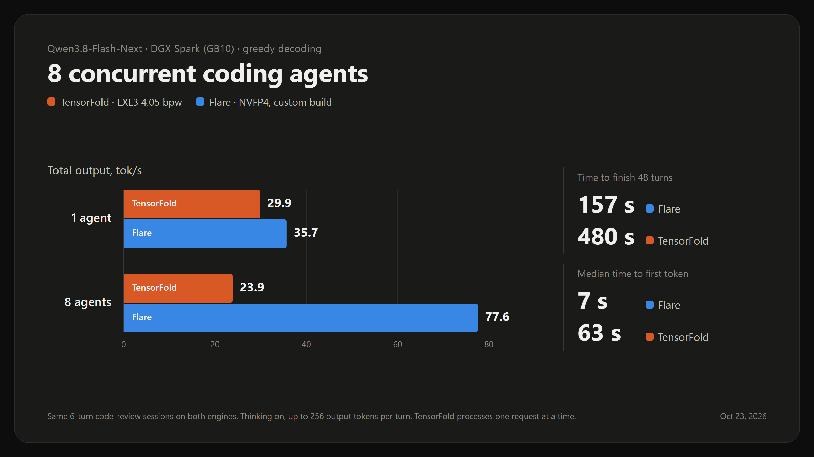
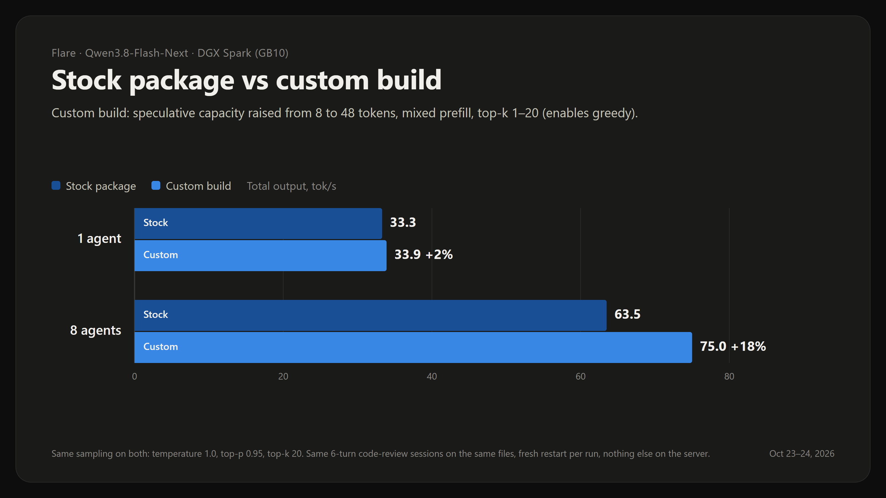
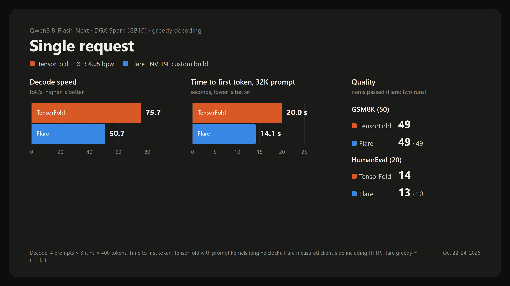
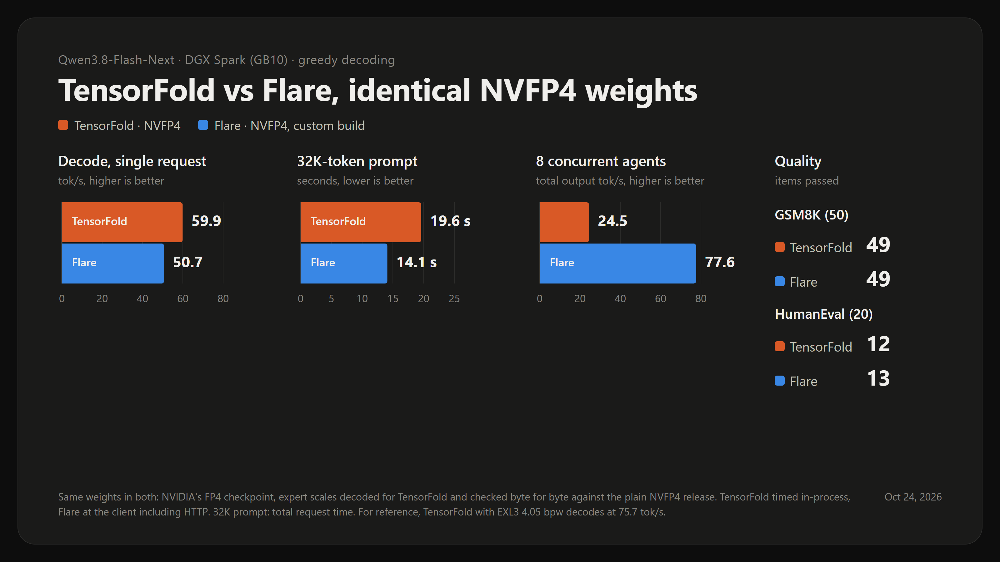
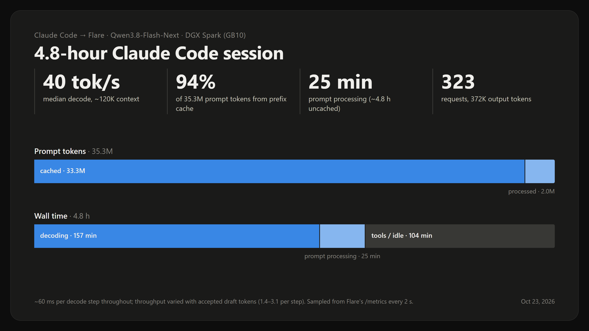

# Qwen3.8 Flash-Next on Flare, one DGX Spark or ASUS Ascent GX10

A **Flare** serving recipe for NVIDIA's NVFP4 Qwen3.8 Flash-Next on one NVIDIA GB10 with 128 GB unified memory. It rebuilds NVIDIA's runtime package from source with three changes the prebuilt package lacks: **greedy decoding** (top-k 1), **speculative capacity for eight concurrent agents**, and **mixed prefill**, then serves it with **three drafts per round**.

**Built for agents.** With eight coding agents at once it produces **3.2×** the output of TensorFold running the EXL3 4.05 recipe, and reaches each agent's first token in 7 s instead of 63 s. One request at a time the engines are close, and quality is the same.



## The recipe

```text
Weights:          nvidia/Qwen3.8-Flash-Next-FP4-Local @ b9ce18a6 (NVFP4 experts, MXFP8 attention, QAD)
Runtime:          Flare 0.1.0 and Ignition, NVIDIA/flare-local-inference @ 1fd1f91, built from source
Patch:            top-k range 1-20 (top-k 1 is greedy); sampling defaults unchanged
Package:          8 request slots, 4 image slots, up to 5 MTP drafts,
                  speculative capacity 48 tokens, mixed prefill graphs
Serving:          3 drafts every round (--no-mtp-adaptive-verification --mtp-draft-tokens 3)
Context:          262,144 tokens
N-gram table:     26.8 GiB, read from disk with a 1 GiB RAM row cache
Prefix cache:     64 snapshot slots, about 1.8M KV tokens
API:              OpenAI, Anthropic and Responses, 127.0.0.1:8000
Model ID:         qwen38-flash-next-flare
Signing:          your own local development key
Hardware:         one GB10, 128 GB unified memory
```

The weights are NVIDIA's own checkpoint; nothing is re-quantized. The package Ignition exports from it is about 108 GB and runs with 76.5 GiB of fixed GPU allocations.

## Results

All runs on one GB10, Qwen3.8-Flash-Next, measured Oct 22 to 24, 2026. TensorFold ran the published EXL3 4.05 recipe (`4.05bpw_h6_ng6`, MTP 6 at 0.70, BF16 KV, prompt kernels on).

### Several agents at once

Six-turn code-review sessions: a shared ~5K-token agent prompt with tool definitions, a new source file each turn, replies up to 256 tokens, thinking on. Greedy on both engines.

| Total output, tok/s | 1 agent | 8 agents | 48 turns finished in | Median first token, 8 agents |
|---|---|---|---|---|
| **Flare, this recipe** | **35.7** | **77.6** | **157 s** | **7 s** |
| TensorFold EXL3 4.05 | 29.9 | 23.9 | 480 s | 63 s |
| TensorFold NVFP4 (same weights as Flare) | 35.0 | 24.5 | 478 s | 65 s |

TensorFold serves one request at a time, so with eight agents the others wait in line and its prompt cache stops hitting (0% reuse). Flare batches all eight and keeps 85% of each prompt cached.

### Stock package vs this build

The same agent sessions on NVIDIA's prebuilt package and on this export, with the sampling the stock package allows (temperature 1.0, top-p 0.95, top-k 20) and adaptive drafting on both:



| Total output, tok/s | 1 agent | 8 agents | Decode per session, 8 agents |
|---|---|---|---|
| Prebuilt package | 33.3 | 63.5 | 10.4 |
| **This build** | **33.9** | **75.0** | **12.8** |

With one agent the two are the same. With eight, the prebuilt package's speculative graphs fit only 8 token rows, so it stops drafting; this build keeps drafting and produces 18% more. Serving with three fixed drafts adds a little more on top (77.6 tok/s greedy).

### One request at a time



| | Decode, tok/s | 32K-token prompt to first token | GSM8K (50) | HumanEval (20) |
|---|---|---|---|---|
| **Flare, this recipe** | 50.7 | **14.1 s** | 49 | 13 (10 on a second run) |
| TensorFold EXL3 4.05 | **75.7** | 20.0 s | 49 | 14 |
| TensorFold NVFP4 | 59.9 | 19.6 s | 49 | 12 |

Decode is the mean of four frozen prompts × three repeats of 400 tokens. The long-prompt probe asks for one token, so its total request time is its time to first token. TensorFold's times use its engine clock, Flare's a client clock including HTTP. Quality uses the harness's own GSM8K extraction and HumanEval Docker sandbox, greedy on both engines. With 70 items, differences of a few items are noise.

### Same weights, different engines

TensorFold also reads NVFP4. NVIDIA's checkpoint stores its expert scales compressed, so they were decoded into plain ModelOpt scales with Flare's own reference decoder; spot checks matched `local-inference-lab/Qwen3.8-Flash-Next-NVFP4` byte for byte. On identical weights the single-request gap mostly closes: TensorFold's lead in single-stream decode comes largely from the EXL3 format, not the engine.



### A real session: 4.8 hours of Claude Code

Claude Code on this recipe built a Kerr black hole visualizer, fully local. Measured from Flare's own counters every 2 s:



- **40 tok/s** median decode with about 120K tokens of context.
- **94%** of 35.3M prompt tokens came from the prefix cache, so prompt processing took 25 minutes instead of about 4.8 hours.
- Each decode step took about 60 ms throughout; speed moved only with how many drafted tokens were accepted (1.4 to 3.1 per step).

## Requirements

- A DGX Spark or ASUS Ascent GX10 on Ubuntu 24.04 with the CUDA 13 toolkit (`nvcc`) under `/usr/local/cuda`.
- **Disk:** about 300 GB free for the export: the 102 GB checkpoint, a ~80 GB staging copy and the 108 GB package. Afterwards the staging copy and the checkpoint can go, leaving the 108 GB package.
- **Time:** about 15 minutes to build, an hour or less to download, about 2 hours for the first export.
- [uv](https://docs.astral.sh/uv/) and [Rust](https://rustup.rs) 1.88 or newer.

## 1. Prepare the host

```bash
sudo apt-get update
sudo apt-get install -y build-essential cmake ninja-build pkg-config protobuf-compiler libssl-dev python3-dev liburing-dev
```

Flare locks its n-gram staging buffers in memory, which needs an unlimited locked-memory limit:

```bash
echo "$USER - memlock unlimited" | sudo tee /etc/security/limits.d/90-flare-memlock.conf
```

Log out and back in, then check that `ulimit -l` prints `unlimited`. The limit applies to logins that go through PAM: the console and OpenSSH. **Tailscale SSH skips PAM**, so a Tailscale SSH session keeps the default 8 MB and Flare fails at "register Engram staging". Run `export.sh` and the first `start-flare.sh` from the console or OpenSSH.

## 2. Build Flare and Ignition

```bash
git clone https://github.com/sxuff/qwen38-flash-next-flare ~/qwen38-flash-next-flare
cd ~/qwen38-flash-next-flare
bash scripts/setup.sh
```

This clones `NVIDIA/flare-local-inference` into `~/flare-local-inference`, checks out the pinned commit, applies [`patches/qwen38-topk-range.patch`](patches/qwen38-topk-range.patch), syncs Ignition's Python environment and builds the Flare runtime. Every path and pin lives in [`scripts/config.sh`](scripts/config.sh) and can be overridden from the environment.

## 3. Download the checkpoint

```bash
bash scripts/download.sh
```

102 GB from `nvidia/Qwen3.8-Flash-Next-FP4-Local` at the pinned revision. The export would fetch it too; downloading first keeps the GPU free meanwhile.

## 4. Export the package

```bash
bash scripts/export.sh
```

Ignition loads the checkpoint, tunes kernels (about 50 min), compiles 135 forwards (about 40 min), warms them, captures 159 CUDA graphs and writes a 108 GB package signed with a development key it creates in `~/.config/flare`. Nothing else may use the GPU meanwhile. The script checks free disk, the memlock limit and the GPU before it starts.

- If an export fails, run it again: kernel and forward caches make a rerun take about 20 minutes.
- Out of disk near the end ("No space left on device") is the common failure: the staging copy and the package exist side by side for a while.
- After a successful export, `bash scripts/clean-staging.sh` lists the staging blobs and `--delete` removes them (about 80 GB). Keep them if you will export again; a rerun reuses them.

## 5. Approve your signing key (first use)

```bash
bash scripts/approve-key.sh
```

Flare verifies every package's signature and asks once before trusting a new key. This prints the fingerprint of your own development key and starts Flare in the foreground; type `local-development` when asked, then stop it with Ctrl-C once the model starts loading. Flare remembers the approval.

## 6. Start the server

```bash
bash scripts/start-flare.sh
```

Flare runs in a dedicated tmux server (`tmux -L flare attach -t flare:0` to watch it) and is ready in about 30 seconds. A `keep` window holds that tmux server open with the memlock limit of the login that created it, so later starts and restarts work from any login, Tailscale SSH included. `bash scripts/stop-flare.sh` stops Flare and leaves the tmux server up.

If another server holds the GPU, set `STOP_SERVICE=<systemd --user unit>`: `start-flare.sh` stops it first and `stop-flare.sh` starts it again.

## 7. Use it

OpenAI-compatible:

```bash
curl -s http://127.0.0.1:8000/v1/chat/completions -H 'Content-Type: application/json' -d '{
  "model": "qwen38-flash-next-flare",
  "messages": [{"role": "user", "content": "Explain the ISCO of a Kerr black hole in two sentences."}],
  "max_tokens": 512
}'
```

**Greedy decoding:** send `"top_k": 1`. Flare refuses `temperature: 0` by design and clamps request values into the package's ranges (temperature 0.7 to 1, top-p 0.8 to 0.95); with top-k 1 only the best token is kept, so those no longer matter. Greedy runs are not bit-for-bit repeatable: the model's scores are BF16, so the two best tokens sometimes tie exactly, and speculative decoding changes the arithmetic slightly between runs.

The Anthropic Messages API is served at `/v1/messages` on the same port, which is what Claude Code uses.

## 8. Claude Code

[`clients/claude-code`](clients/claude-code) holds a settings profile and launchers for Windows (`claude-flare.ps1`) and macOS or Linux (`claude-flare.sh`). They start Flare if needed, open an SSH tunnel from `localhost:18000` to the Spark and run `claude` with the profile.

```bash
export FLARE_SPARK=user@spark              # key-based SSH to the Spark
export FLARE_SPARK_LOGIN=user@spark.local  # a PAM login, used only for the first start after boot
bash clients/claude-code/claude-flare.sh
```

Every model slot (main, subagents, background) points at the one model, so Claude Code's parallel requests land on Flare's eight request slots.

## Benchmarks

- [`bench/agents_bench.py`](bench/agents_bench.py): the agent-session test above. `FLARE_SRC=~/flare-local-inference python3 bench/agents_bench.py --levels 1 8 --reps 1 --sampling-json '{"top_k": 1}' --out agents.json`. It draws its files from the Flare checkout made by `setup.sh`, so the workload is the same on any machine.
- [`bench/live_metrics.py`](bench/live_metrics.py) and [`bench/meter_report.py`](bench/meter_report.py): a passive speed meter for a real session, sampling Flare's `/metrics` every 2 s, and its report.
- Decode, long-prompt and quality figures come from the frozen `flashnext-tf405` harness of the TensorFold recipe: four speed prompts × three repeats, three long-prompt probes, 50 GSM8K and 20 HumanEval items.

## Notes

- **Greedy and the stock package.** NVIDIA's prebuilt package fixes every sampling parameter; requests can only set the seed. That is why this recipe re-exports with a top-k range.
- **Drafting with many agents.** The prebuilt package captured speculative graphs for at most 8 token rows, so with eight requests in a batch drafting switched off. This export captures widths 1 to 6 for batches up to 8 (48 rows): +18% total output with eight agents.
- **Benchmark hygiene.** Nothing else may use the server during a run; one stock-package run that shared it with a live Claude Code session came out at less than half speed. The agent workload also depends on the files in the checkout, so compare runs made on the same checkout.
- **Fixed three drafts** beat adaptive verification and five fixed drafts on the agent workload (1 and 8 agents); five drafts was fastest only on single-stream decode.
- One export attempt failed during warm-up with a one-off CUDA illegal instruction (Xid 13); the next attempt, with the same cached kernels, succeeded.

## Licenses

This repository is MIT. [`patches/`](patches) modifies NVIDIA's [flare-local-inference](https://github.com/NVIDIA/flare-local-inference), licensed under Apache 2.0. The model weights are under the NVIDIA Open Model Agreement, which Flare shows when you first approve a package.
