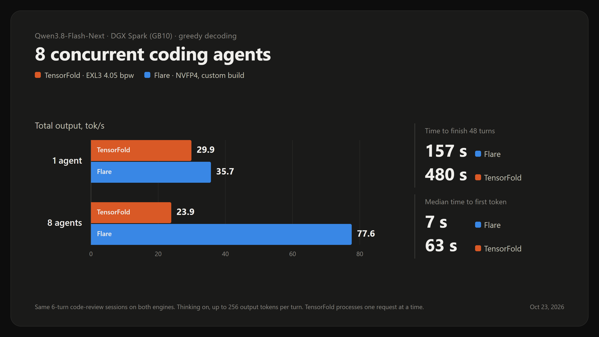
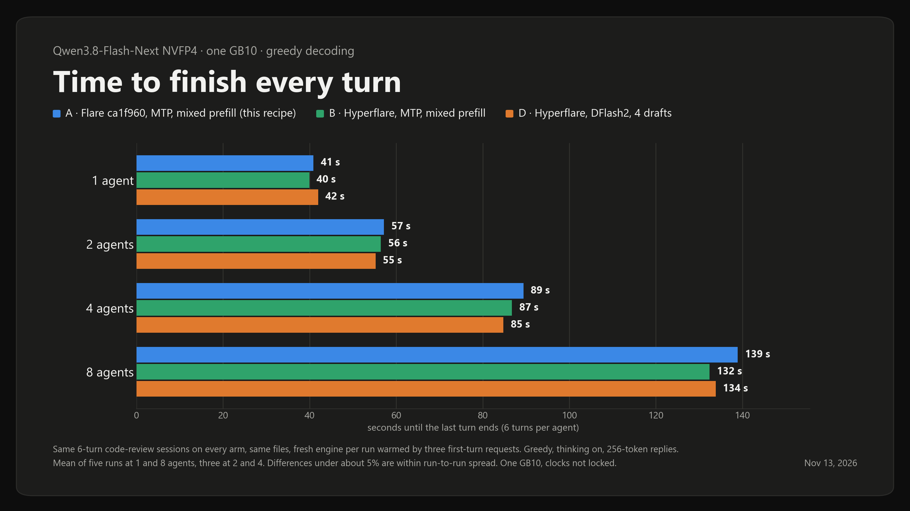
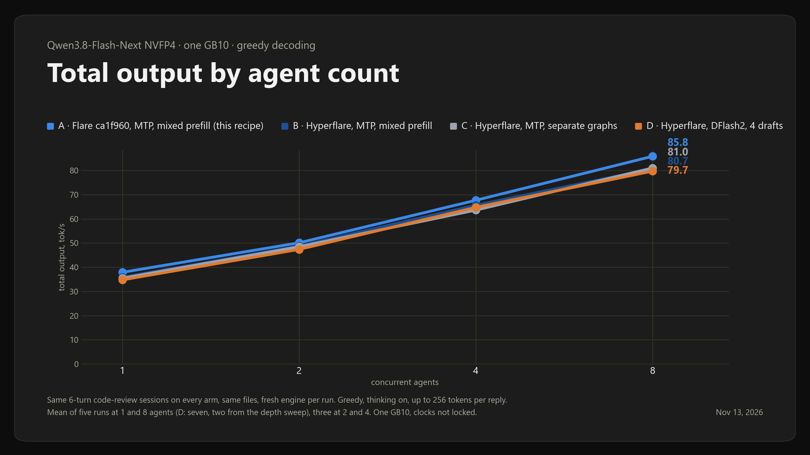
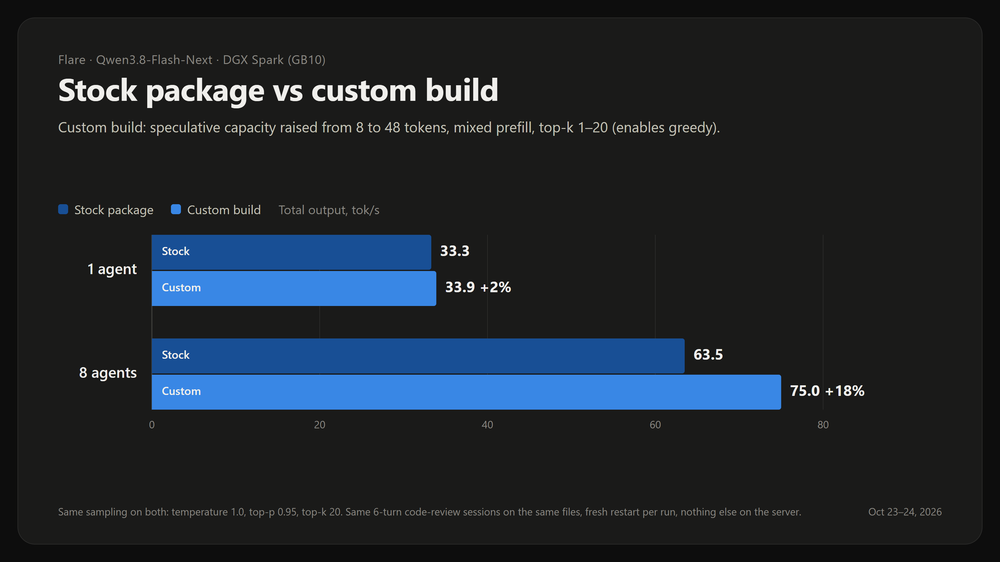
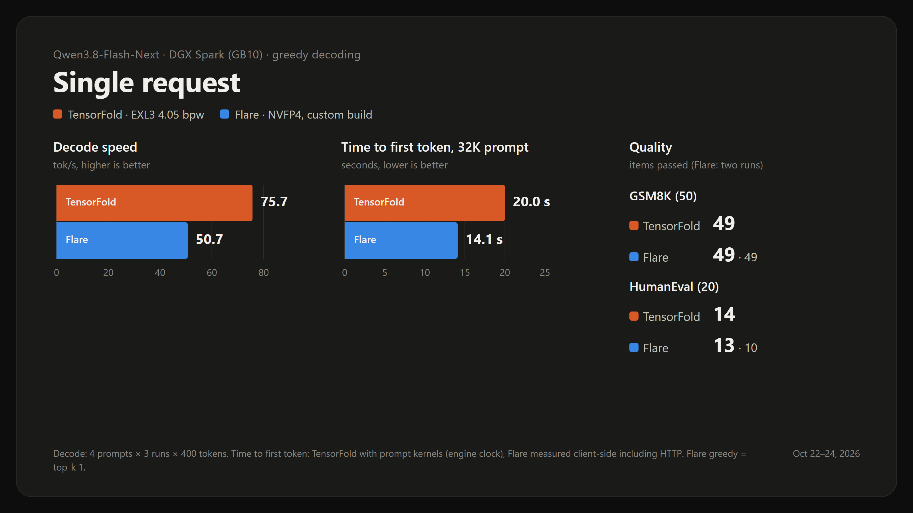
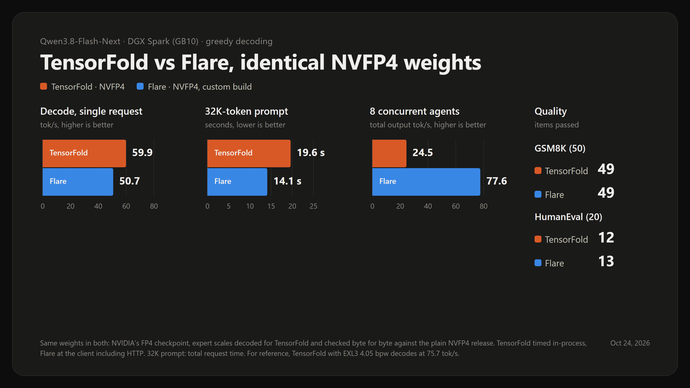
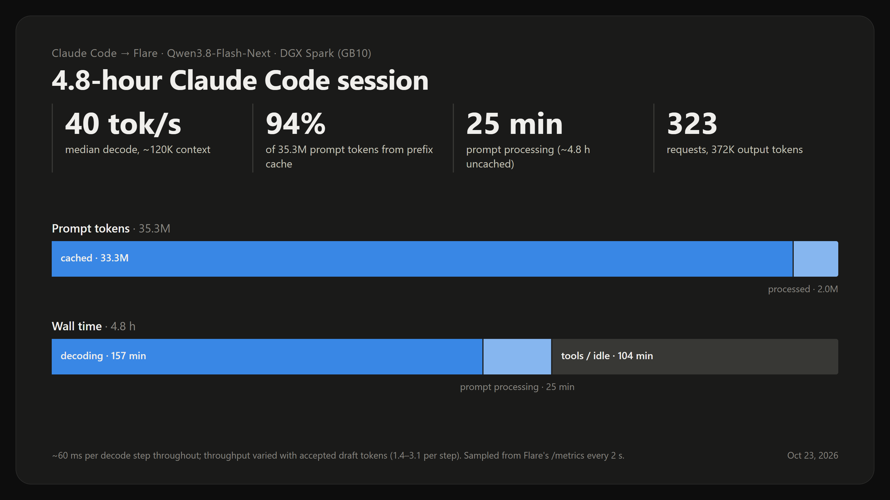

# Qwen3.8 Flash-Next on Flare, one DGX Spark or ASUS Ascent GX10

## Which config should I run?

Measured Nov 12–13, 2026 on one GB10: this recipe (A, Flare `ca1f960`) against NVIDIA's newer Hyperflare engine with MTP (B) and with the DFlash2 drafter (D). Headline: **time until every agent's six turns are done**, lower is better, on an engine that has already served a few requests, as a running agent server has. Mean of five runs at 1 and 8 agents, three at 2 and 4. Raw numbers and every pin: [`results/v2`](results/v2).

| Workload | Fastest | Its time | This recipe (A) | Margin over A |
|---|---|---|---|---|
| 1 agent | B, Hyperflare, MTP + mixed prefill | 39.9 s | 40.9 s | 2%, within noise |
| 2 agents | D, Hyperflare + DFlash2 (B 56.5 s) | 55.2 s | 57.2 s | 2–3%, within noise |
| 4 agents | D, Hyperflare + DFlash2 (B 86.8 s) | 84.8 s | 89.4 s | 3–5% |
| 8 agents | **B, Hyperflare, MTP + mixed prefill** (D 133.8 s) | **132.4 s** | 138.9 s | **5%** |
| One request, short prompts (decode) | D, Hyperflare + DFlash2 | 55.5 tok/s | 52.7 tok/s | 5% |
| One 32K-token prompt | D, Hyperflare + DFlash2 | 13.3 s | 14.0 s | 5% |

**The crossover is at about 4 agents:** below it the three are tied, from 4 agents on Hyperflare is a few percent ahead, and B and D are tied with each other for agents. The margins are small: at 8 agents B's runs took 128.0 to 137.7 s and A's 135.1 to 145.8 s (exact permutation test p = 0.08; p = 0.10 at 4 agents). DFlash2 adds nothing for agents; it wins one request at a time, and that is the drafter, not the extra draft: MTP with four drafts is no faster than with three.

**Restarted often? Then this recipe is faster.** A freshly started Hyperflare engine does not snapshot the end of a shared system prompt until it has timed a few requests, so its first new sessions re-read the whole prompt: measured that way, A finishes 8 agents in 137.0 s against 144.5 s, and its slowest first tokens are 3× sooner ([details](#fresh-engine-vs-running-server)). This recipe's numbers are the same either way.

**Default: Hyperflare with MTP and mixed prefill (B).** `./run.sh` and `./run.sh --mode agents` build and serve it, and so does `./run.sh --mode single`, because it is also the fastest at one agent (by a margin within noise). `PROFILE=flare-mtp-mixed ./run.sh` serves this recipe's original build (no re-export if you already have it); `PROFILE=hyperflare-dflash2 ./run.sh` serves DFlash2 for one-request decode. Quality is the same on all of them.

## Run it

```bash
git clone https://github.com/sxuff/qwen38-flash-next-flare && cd qwen38-flash-next-flare && ./run.sh
```

Expected: **88.3 tok/s** total output with eight concurrent coding agents, all 48 turns done in 132.4 s on a warmed engine (Hyperflare, MTP, mixed prefill; mean of five runs, Nov 13, 2026; receipt: [`results/v2/summary.json`](results/v2/summary.json)). This recipe's original build measured 83.0 tok/s in v1 (Oct 28–29; tables below, kept as measured) and 85.4 tok/s in v2.

Modes: `./run.sh --mode agents` (default) and `./run.sh --mode single` choose the measured configuration; `./run.sh --check` prints what would happen and changes nothing. The default now builds Hyperflare `8a887202` into `~/hyperflare-inference`; its first export took about 4 hours on a GB10 (50 min of kernel tuning, 2 h 44 min compiling 135 forwards) and needs the same disk as below. Sections 1 to 6 describe this recipe's original Flare build, which `PROFILE=flare-mtp-mixed` selects; the Hyperflare profiles use the same scripts and steps.

First run: do [Prepare the host](#1-prepare-the-host) once and start `./run.sh` from the console or OpenSSH (Tailscale SSH skips the memlock limit). It stops once for you to approve your package's key and licence with `bash scripts/approve-key.sh`.

A **Flare** serving recipe for NVIDIA's NVFP4 Qwen3.8 Flash-Next on one NVIDIA GB10 with 128 GB unified memory. It rebuilds NVIDIA's runtime package from source with three changes the prebuilt package lacks: **greedy decoding** (top-k 1), **speculative capacity for eight concurrent agents**, and **mixed prefill**, then serves it with **three drafts per round** on a Flare runtime patched for agents: **oldest-first prefix-cache eviction** and **prompts first** in the scheduler.

**Built for agents.** With eight coding agents at once it produces **3.5×** the output of TensorFold running the EXL3 4.05 recipe, and reaches each agent's first token in 2.7 s instead of 63 s. One request at a time the engines are close, and quality is the same.



## The recipe

```text
Weights:          nvidia/Qwen3.8-Flash-Next-FP4-Local @ b9ce18a6 (NVFP4 experts, MXFP8 attention, QAD)
Runtime:          Flare 0.1.0 and Ignition, NVIDIA/flare-local-inference @ ca1f960, built from source
Patches:          top-k range 1-20 (top-k 1 is greedy; sampling defaults unchanged);
                  mixed-prefill export fix (upstream bug since Oct 24);
                  oldest-first prefix-snapshot eviction (upstream's order since Oct 23 costs 30% with 8 agents);
                  prompt priority setting (FLARE_PREFILL_PRIORITY)
Package:          8 request slots, 4 image slots, up to 5 MTP drafts,
                  speculative capacity 48 tokens, mixed prefill graphs
Serving:          3 drafts every round (--no-mtp-adaptive-verification --mtp-draft-tokens 3),
                  throughput scheduler (--scheduler-policy throughput), FLARE_PREFILL_PRIORITY=16
Context:          262,144 tokens
N-gram table:     26.8 GiB, read from disk with a 1 GiB RAM row cache
Prefix cache:     64 snapshot slots, about 1.8M KV tokens, GPU memory only
API:              OpenAI, Anthropic and Responses, 127.0.0.1:8000
Model ID:         qwen38-flash-next-flare
Signing:          your own local development key
Hardware:         one GB10, 128 GB unified memory
```

The weights are NVIDIA's own checkpoint; nothing is re-quantized. The package Ignition exports from it is about 107 GB (100 GiB) and runs with 76.5 GiB of fixed GPU allocations.

## v2 results: Flare recipe vs Hyperflare with DFlash2

Measured Nov 12–13, 2026 on one ASUS Ascent GX10. Every run's numbers, clocks and pins: [`results/v2`](results/v2); the harness that ran them: [`bench/v2`](bench/v2).





### The arms

| Arm | Engine | Drafts | Prefill | Isolates |
|---|---|---|---|---|
| **A** | Flare `ca1f960` + the four v1 patches; v1's package `gb10-tp1-202610271753` | MTP, 3 fixed | mixed | reference (this recipe) |
| **B** | Hyperflare `8a887202` + [2 patches](patches/hyperflare) | MTP, 3 fixed | mixed | the new engine |
| **C** | Hyperflare `8a887202` + 2 patches | MTP, 3 fixed | separate graphs | losing mixed prefill |
| **D** | Hyperflare `8a887202` + 2 patches | DFlash2, 4 fixed | separate graphs | gaining DFlash2 |

All arms use the same weights (`nvidia/Qwen3.8-Flash-Next-FP4-Local@b9ce18a6`; all 33 files match the hashes in `run.sh`), the same capacity (8 requests, 4 image slots; MTP exports up to 5 drafts in 48 speculative tokens, DFlash2 up to 6 in 56), the throughput scheduler, `FLARE_PREFILL_PRIORITY=16` and greedy decoding (top-k 1).

- **Hyperflare** is `NVIDIA/flare-local-inference` renamed (`d2b5c5f`, Nov 8); `ca1f960` is 250 commits behind `8a887202`. Of v1's four patches, top-k range and prompt priority are still needed; the mixed-prefill export fix and oldest-first eviction are upstream in other forms ([details](patches/hyperflare/README.md)).
- **DFlash2 cannot use mixed prefill:** `ignition/planning.py` rejects `--speculative-method dflash2` with `--mixed-prefill` ("requires separate prefill and verification graphs"). C separates that loss from the drafter.
- **The drafter** is `incoai/Qwen3.8-Flash-Next-DFlash2@a22a1744` (sha256 `d6723f2a…3186f`), the revision Hyperflare pins. Its card names `Qwen/Qwen3.8-Flash-Next` as the base and was evaluated on the FP8 checkpoint, not NVIDIA's NVFP4 QAD weights used here.
- **Draft depth** was swept around upstream's default of 5 (fresh engine, 2 runs each at 1 and 8 agents): 4 drafts 79.2 tok/s with eight agents, 5 drafts 79.1, 6 drafts 76.6. Four was kept.

### Several agents at once (warmed engine)

`bench/agents_bench.py`, unchanged: six-turn code-review sessions, replies up to 256 tokens, thinking on. Each run starts a fresh engine and first sends it three first-turn requests built from source files the benchmark never uses (`prewarm` in `bench/v2/driver.py`), so it behaves like a server that is already running. Mean of five runs at 1 and 8 agents, three at 2 and 4; arms interleaved.

| Time to finish all turns | 1 agent | 2 agents | 4 agents | 8 agents | 8 agents, single runs |
|---|---|---|---|---|---|
| A, this recipe | 40.9 s | 57.2 s | 89.4 s | 138.9 s | 135.1 to 145.8 s |
| **B, Hyperflare, MTP, mixed prefill** | **39.9 s** | 56.5 s | 86.8 s | **132.4 s** | 128.0 to 137.7 s |
| D, Hyperflare, DFlash2 | 42.0 s | **55.2 s** | **84.8 s** | 133.8 s | 127.2 to 140.4 s |

| 8 agents | Total output | First token, median | First token, p90 | Longest pause in a reply, p90 | Prompt cached | Accepted drafts per round |
|---|---|---|---|---|---|---|
| A | 85.4 tok/s | 2.2 s | 6.7 s | 3.2 s | 85% | 1.65 of 3 |
| B | 88.3 tok/s | 2.0 s | 6.6 s | 2.7 s | 85% | 1.65 of 3 |
| D | **88.5 tok/s** | **1.8 s** | **6.3 s** | **2.6 s** | 85% | 1.88 of 4 |

- **Hyperflare is a few percent faster from four agents on**, with the same prompt-cache hits and the same acceptance as this recipe: B against A is −4.7% at 8 agents and −3.0% at 4 (exact permutation tests on the runs: p = 0.08 and 0.10). At 1 and 2 agents the differences are within noise (p ≥ 0.26).
- **DFlash2 and MTP are tied for agents** (B against D: p = 0.66 at 8 agents). Per draft position DFlash2 is accepted about as often as MTP on these weights (first draft 0.74 against 0.75, second 0.50 against 0.52, third 0.33 against 0.36), so its fourth draft adds acceptance but costs a longer step.
- Peak engine memory was 101 to 103 GiB on every arm.

### Fresh engine vs running server

The first v2 runs started each engine fresh with only the benchmark's own warm-up request, as v1 did. That is where Hyperflare lost:

| Fresh engine, time to finish | 1 agent | 2 agents | 4 agents | 8 agents | 8 agents, first token p90 | Prompt cached, 8 agents |
|---|---|---|---|---|---|---|
| **A, this recipe** | **40.6 s** | **57.6 s** | **89.7 s** | **137.0 s** | **7.0 s** | **85%** |
| B | 40.8 s | 60.7 s | 92.0 s | 144.5 s | 19.6 s | 77% |
| C, Hyperflare, MTP, separate graphs | 43.4 s | 60.7 s | 91.6 s | 145.0 s | 19.6 s | 77% |
| D | 43.0 s | 61.3 s | 93.7 s | 149.2 s | 18.8 s | 77% |

The whole difference is each session's first turn: on a fresh Hyperflare engine it reused 0% of its prompt, against 77% on this recipe; turns 2 to 6 were the same on both. Hyperflare saves a snapshot at the last complete message of every prompt, and at earlier message boundaries (here the end of the shared system prompt and tools) only within a budget that needs measured prefill and snapshot costs; until it has timed a few requests it skips them ([`helios/src/scheduler/checkpoints.rs`](https://github.com/NVIDIA/hyperflare-inference/blob/8a887202a0ee55d456ddcf7510161e22865505bc/helios/src/scheduler/checkpoints.rs), "Unknown costs disable extras"). In a probe the first three new sessions after a start reused nothing and every later one reused the 4,683-token system prompt; raising `--scheduler-checkpoint-extra-work-fraction` from 0.05 to 1 changed nothing. This recipe's Flare saves those snapshots from the start, and warming changed its numbers by at most 1.4% (p ≥ 0.45). Hyperflare never evicted a snapshot in any run, so v1's eviction patch is not what it misses.

So after a restart, the first few agent sessions on Hyperflare re-read their whole system prompt, and a fleet started all at once pays that together. Losing mixed prefill cost little: C was within 0.5% of B at 2, 4 and 8 agents and 6% slower at one agent (C was measured only on fresh engines).

### One request at a time

The frozen `flashnext-tf405` harness from v1: four prompts × three repeats × 400 tokens, and its long-prompt probes. Three runs per arm, each on a fresh engine; these prompts share no system prompt, so warming does not apply.

| | Decode, tok/s | 32K-token prompt to first token | Target step | Accepted drafts per round |
|---|---|---|---|---|
| A, this recipe | 52.7 | 14.0 s | 57.8 ms | 2.00 of 3 |
| B | 51.3 | 13.8 s | 58.7 ms | 1.96 of 3 |
| C | 51.3 | 13.9 s | 58.6 ms | 1.97 of 3 |
| B with 4 MTP drafts | 51.4 | 13.9 s | 64.7 ms | 2.24 of 4 |
| **D, DFlash2** | **55.5** | **13.3 s** | 64.0 ms | 2.44 of 4 |

D decodes 5% faster one request at a time (its runs 54.7 to 56.2 tok/s, A's 52.0 to 53.3). That is the drafter, not the extra draft: Hyperflare's MTP with four drafts gains acceptance (2.24 against 1.96 per round) but loses it again to a longer step, and decodes at 51.4 tok/s, the same as with three. At four drafts the same step time buys DFlash2 2.44.

### Is the drafter held back by the NVFP4 weights?

The DFlash2 drafter was trained for the BF16 model and evaluated on the FP8 one; its card reports 6% (GSM8K) to 17% (HumanEval) longer accepted runs than MTP. On these NVFP4 weights, on the harness's GSM8K and HumanEval prompts, one request at a time:

| Accepted run per verification step | 3 drafts | 4 drafts | Accepted at draft position 1 / 2 / 3, 3 drafts |
|---|---|---|---|
| MTP (Hyperflare) | 3.31 | 3.76 | 0.91 / 0.77 / 0.63 |
| DFlash2 | **3.55 (+7%)** | **4.12 (+10%)** | 0.94 / 0.85 / 0.76 |

So the drafter keeps most of its advantage on NVFP4, and training an NVFP4-specific one has little to gain on prompts like these. Where it loses its edge is the agent workload: on the 6K- to 15K-token code-review sessions DFlash2 and MTP are accepted equally often. Its draft layers attend only to the last 2,048 accepted positions, which may be why; that was not tested.

### Quality

The same harness's 50 GSM8K and 20 HumanEval items, its own extraction and Docker sandbox, seeds 405 and 406:

| | GSM8K (50) | HumanEval (20) |
|---|---|---|
| A, this recipe | 49, 49 | 11, 14 |
| B, Hyperflare, MTP | 49, 48 | 13, 13 |
| B with 4 MTP drafts | 49, 49 | 14, 14 |
| D, DFlash2, 3 drafts | 49, 49 | 14, 11 |
| D, DFlash2, 4 drafts | 49, 49 | 12, 14 |

The same. Greedy runs are not bit-for-bit repeatable (between 6 and 14 of the 70 outputs were identical across the two seeds), so HumanEval moves by a few items between runs.

### How it was run

- One engine at a time, started fresh for every run and stopped after it; the GPU cooled to 50 °C (at least 90 s) between runs. Nothing else used the GPU; the driver records any other GPU process and none appeared.
- GPU clocks at the default, not locked; every run records clocks, temperature and power every 2 s (graphics clock 2.39 to 2.42 GHz, no throttle reason recorded, at most 77 °C).
- Arms interleaved (A B B A …) so drift over the day favours none. The agent workload reads its files from the same `ca1f960` checkout for every arm.
- Acceptance is accepted draft tokens per request verification round from the engine's counters; target step is one-request decode time divided by verification rounds. Significance: exact two-sided permutation tests on per-run times.
- **D's package was not one uninterrupted export.** Its export stopped on a 15 GB free-disk guard near the end; the package was then assembled from that export's saved preparation with Hyperflare's own publisher and verified with `flare inspect` (signatures and every prepared blob). The saved preparation is the DFlash2 one (`--speculative-method dflash2`, with the drafter's selector); against C only the draft-module weights, graphs and kernels differ. Details in [`results/v2/pins.json`](results/v2/pins.json).
- The one-request runs' raw files were first saved under the harness directory (a relative path in `bench/v2/driver.py`, now fixed) and copied unchanged into `results/v2/raw` before scoring.

## v1 results (October 2026, kept as measured)

All runs on one GB10 with Qwen3.8-Flash-Next. This recipe's agent and single-request speed were measured Oct 28 and 29, 2026, and so were the Flare figures in the eight-agents card at the top; everything else, including quality, the other figures and TensorFold, Oct 22 to 24, when the recipe ran the previous Flare pin (1fd1f91) without runtime patches. TensorFold ran the published EXL3 4.05 recipe (`4.05bpw_h6_ng6`, MTP 6 at 0.70, BF16 KV, prompt kernels on).

### Several agents at once

Six-turn code-review sessions: a shared ~5K-token agent prompt with tool definitions, a new source file each turn, replies up to 256 tokens, thinking on. Greedy on both engines. This recipe's row is the mean of five runs; with eight agents, single runs ranged from 79.7 to 85.8 tok/s.

| Total output, tok/s | 1 agent | 8 agents | 48 turns finished in | Median first token, 8 agents |
|---|---|---|---|---|
| **Flare, this recipe** | **38.0** | **83.0** | **143 s** | **2.7 s** |
| Flare, previous recipe (1fd1f91) | 35.7 | 77.6 | 157 s | 7 s |
| TensorFold EXL3 4.05 | 29.9 | 23.9 | 480 s | 63 s |
| TensorFold NVFP4 (same weights as Flare) | 35.0 | 24.5 | 478 s | 65 s |

TensorFold serves one request at a time, so with eight agents the others wait in line and its prompt cache stops hitting (0% reuse). Flare batches all eight and keeps 85% of each prompt cached.

### What each runtime change adds

The same eight-agent sessions on Flare ca1f960 with three fixed drafts, adding one change at a time. Each row is the mean of two runs, except two: the throughput row ran in two separate sweeps, so it shows both means, and the last row is the mean of five runs.

| Flare ca1f960 | 8 agents, tok/s | 48 turns finished in | Median first token | Prompt cached |
|---|---|---|---|---|
| No runtime patches | 54.4 | 215 s | 10.9 s | 70% |
| + oldest-first eviction | 77.6 | 153 s | 7.1 s | 85% |
| + throughput scheduler | 82.1 to 83.0 | 148 s | 5.0 to 5.5 s | 85% |
| **+ prompt priority 16 (this recipe)** | **83.0** | **143 s** | **2.7 s** | 85% |

- **Eviction.** Upstream commit `2c99983e` (Oct 23) changed which prefix snapshot Flare drops first when its 64 slots fill: closely spaced checkpoints now go before the oldest ones. With eight agents that cuts the cached share of each prompt from 85% to 70%, and the unpatched runtime is 30% slower than the previous pin. [`flare-oldest-first-eviction.patch`](patches/flare-oldest-first-eviction.patch) restores the oldest-first order.
- **Throughput scheduler.** `--scheduler-policy throughput` is Flare's own preset; it turns off two of the scheduler's fairness prices (delivery fairness and decode age).
- **Prompt priority.** Flare's scheduler values a prompt token at 1/64 of an output token, so a new turn's prompt waits until its fairness price has risen. [`flare-prefill-priority.patch`](patches/flare-prefill-priority.patch) multiplies the value of prompt work by `FLARE_PREFILL_PRIORITY` (unset means 1, upstream's pricing). At 16 each turn starts decoding sooner: the median first token was 2.4 to 3.0 s in all five runs, against 4.3 to 6.1 s in the four runs with the throughput scheduler alone. Total output barely moves: single runs ranged from 79.7 to 85.8 tok/s with priority 16 and 80.8 to 85.2 without, so its gain in throughput is within run-to-run noise.
- **The cost of prompts first:** a reply already streaming pauses while another agent's prompt is processed. With eight agents, the 90th percentile of each reply's longest pause between tokens is 2.5 to 4.5 s, against 1.4 to 1.5 s without prompt priority. A long prompt does not freeze the others: with seven agents running and 8K- and 32K-token prompts arriving as an eighth client, the longest pause in two runs was 5.3 s at priority 16 and 8.8 s without priority, and the 32K prompt reached its first token in 16.1 s instead of 22.1 s. Priority 4 was as fast with eight agents (84.0 tok/s, two runs) and reached the first token in 3.1 to 3.4 s, but had the single longest pause in the long-prompt test, 11.8 s.

### Stock package vs this build

The same agent sessions on NVIDIA's prebuilt package and on this export, with the sampling the stock package allows (temperature 1.0, top-p 0.95, top-k 20) and adaptive drafting on both:



| Total output, tok/s | 1 agent | 8 agents | Decode per session, 8 agents |
|---|---|---|---|
| Prebuilt package | 33.3 | 63.5 | 10.4 |
| **This build** | **33.9** | **75.0** | **12.8** |

With one agent the two are the same. With eight, the prebuilt package's speculative graphs fit only 8 token rows, so it stops drafting; this build keeps drafting and produces 18% more. Serving with three fixed drafts added a little more on top (77.6 tok/s greedy, on the previous pin).

### One request at a time



| | Decode, tok/s | 32K-token prompt to first token | GSM8K (50) | HumanEval (20) |
|---|---|---|---|---|
| **Flare, this recipe** | 52.5 | **13.4 s** | – | – |
| Flare, previous recipe (1fd1f91) | 50.7 | 14.1 s | 49 | 13 (10 on a second run) |
| TensorFold EXL3 4.05 | **75.7** | 20.0 s | 49 | 14 |
| TensorFold NVFP4 | 59.9 | 19.6 s | 49 | 12 |

Quality was scored on the previous recipe and not re-run on this one. Decode is the mean of four frozen prompts × three repeats of 400 tokens. The long-prompt probe asks for one token, so its total request time is its time to first token. TensorFold's times use its engine clock, Flare's a client clock including HTTP. Quality uses the harness's own GSM8K extraction and HumanEval Docker sandbox, greedy on both engines. With 70 items, differences of a few items are noise.

### Same weights, different engines

TensorFold also reads NVFP4. NVIDIA's checkpoint stores its expert scales compressed, so they were decoded into plain ModelOpt scales with Flare's own reference decoder; spot checks matched `local-inference-lab/Qwen3.8-Flash-Next-NVFP4` byte for byte. On identical weights the single-request gap mostly closes: TensorFold's lead in single-stream decode comes largely from the EXL3 format, not the engine.



### A real session: 4.8 hours of Claude Code

Claude Code on this recipe built a Kerr black hole visualizer, fully local. Measured from Flare's own counters every 2 s:



- **40 tok/s** median decode with about 120K tokens of context.
- **94%** of 35.3M prompt tokens came from the prefix cache, so prompt processing took 25 minutes instead of about 4.8 hours.
- Each decode step took about 60 ms throughout; speed moved only with how many drafted tokens were accepted (1.4 to 3.1 per step).

## Requirements

- A DGX Spark or ASUS Ascent GX10 on Ubuntu 24.04 with the CUDA 13 toolkit (`nvcc`) under `/usr/local/cuda`.
- **Disk:** about 230 GB free: the 102 GB checkpoint, the 107 GB package and about 20 GB of kernel caches. Ignition hard-links its staging files into the package, so there is no second copy. Afterwards the checkpoint can go.
- **Time:** about 15 minutes to build, an hour or less to download, about 1.5 hours for the first export.
- [uv](https://docs.astral.sh/uv/) and [Rust](https://rustup.rs) 1.88 or newer.

## 1. Prepare the host

```bash
sudo apt-get update
sudo apt-get install -y build-essential cmake ninja-build pkg-config protobuf-compiler libssl-dev python3-dev liburing-dev
```

Flare locks its n-gram staging buffers in memory, which needs an unlimited locked-memory limit:

```bash
echo "$USER - memlock unlimited" | sudo tee /etc/security/limits.d/90-flare-memlock.conf
```

Log out and back in, then check that `ulimit -l` prints `unlimited`. The limit applies to logins that go through PAM: the console and OpenSSH. **Tailscale SSH skips PAM**, so a Tailscale SSH session keeps the default 8 MB and Flare fails at "register Engram staging". Run `export.sh` and the first `start-flare.sh` from the console or OpenSSH.

## 2. Build Flare and Ignition

```bash
git clone https://github.com/sxuff/qwen38-flash-next-flare ~/qwen38-flash-next-flare
cd ~/qwen38-flash-next-flare
bash scripts/setup.sh
```

This clones `NVIDIA/flare-local-inference` into `~/flare-local-inference`, checks out the pinned commit, applies the four patches in [`patches/`](patches), syncs Ignition's Python environment (rebuilding the patched native exporter) and builds the Flare runtime. Every path and pin lives in [`scripts/config.sh`](scripts/config.sh) and can be overridden from the environment.

## 3. Download the checkpoint

```bash
bash scripts/download.sh
```

102 GB from `nvidia/Qwen3.8-Flash-Next-FP4-Local` at the pinned revision. The export would fetch it too; downloading first keeps the GPU free meanwhile.

## 4. Export the package

```bash
bash scripts/export.sh
```

Ignition loads the checkpoint, tunes kernels (about 40 min), compiles 135 forwards (about 25 min), warms them, captures 159 CUDA graphs and publishes a 107 GB package into Flare's model cache (`~/.cache/flare/packages`), signed with a development key it creates in `~/.config/flare`. `export.sh` records the new cache entry in `~/.local/state/qwen38-flash-next-flare/package`, where the other scripts find it. Nothing else may use the GPU meanwhile. The script checks free disk, the memlock limit and the GPU before it starts.

- If an export fails, run it again: kernel and forward caches make a rerun take about 30 minutes.
- To re-export after a change to the export flags or the Flare build, `bash scripts/export.sh --reuse-weights` skips rehashing the weights (about 17 minutes). The weights are shared between versions, so a second version adds only about 1 GB.
- `flare models list` shows the exported versions; `flare models remove MODEL@VERSION` and then `flare models gc` free an old one.
- Packages exported by the earlier pin (1fd1f91, a single `.safetensors` file) do not load in this Flare: it asks for a re-export.

## 5. Approve your signing key (first use)

```bash
bash scripts/approve-key.sh
```

Flare verifies every package's signature and asks once before trusting a new key. This prints the fingerprint of your own development key and starts Flare in the foreground; type `local-development` when asked, then stop it with Ctrl-C once the model starts loading. Flare remembers the approval.

## 6. Start the server

```bash
bash scripts/start-flare.sh
```

Flare runs in a dedicated tmux server (`tmux -L flare attach -t flare:0` to watch it) and is ready in about 30 seconds. A `keep` window holds that tmux server open with the memlock limit of the login that created it, so later starts and restarts work from any login, Tailscale SSH included. `bash scripts/stop-flare.sh` stops Flare and leaves the tmux server up.

If another server holds the GPU, set `STOP_SERVICE=<systemd --user unit>`: `start-flare.sh` stops it first and `stop-flare.sh` starts it again.

Flare serves with three drafts per round, the throughput scheduler and `FLARE_PREFILL_PRIORITY=16`, so each agent's new turn starts sooner (see [What each runtime change adds](#what-each-runtime-change-adds)). `SERVE_FLAGS` and `PREFILL_PRIORITY` change them; `PREFILL_PRIORITY=1` is upstream's scheduling.

Flare can also keep its prefix cache on disk, but the recipe leaves that off (measurements in [Notes](#notes)). `PREFIX_CACHE_DISK_LIMIT=20G` turns it on: every prefix snapshot is also written to `~/.cache/flare/prefix-cache` (`PREFIX_CACHE_DISK` moves it), and one evicted from the GPU is read back when its session returns. Flare keeps one subdirectory per package layout, so after a re-export the old ones can be deleted while Flare is stopped.

## 7. Use it

OpenAI-compatible:

```bash
curl -s http://127.0.0.1:8000/v1/chat/completions -H 'Content-Type: application/json' -d '{
  "model": "qwen38-flash-next-flare",
  "messages": [{"role": "user", "content": "Explain the ISCO of a Kerr black hole in two sentences."}],
  "max_tokens": 512
}'
```

**Greedy decoding:** send `"top_k": 1`. Flare refuses `temperature: 0` by design and clamps request values into the package's ranges (temperature 0.7 to 1, top-p 0.8 to 0.95); with top-k 1 only the best token is kept, so those no longer matter. Greedy runs are not bit-for-bit repeatable: the model's scores are BF16, so the two best tokens sometimes tie exactly, and speculative decoding changes the arithmetic slightly between runs.

The Anthropic Messages API is served at `/v1/messages` on the same port, which is what Claude Code uses.

## 8. Claude Code

[`clients/claude-code`](clients/claude-code) holds a settings profile and launchers for Windows (`claude-flare.ps1`) and macOS or Linux (`claude-flare.sh`). They start Flare if needed, open an SSH tunnel from `localhost:18000` to the Spark and run `claude` with the profile.

```bash
export FLARE_SPARK=user@spark              # key-based SSH to the Spark
export FLARE_SPARK_LOGIN=user@spark.local  # a PAM login, used only for the first start after boot
bash clients/claude-code/claude-flare.sh
```

Every model slot (main, subagents, background) points at the one model, so Claude Code's parallel requests land on Flare's eight request slots.

## Benchmarks

- [`bench/agents_bench.py`](bench/agents_bench.py): the agent-session test above. `FLARE_SRC=~/flare-local-inference python3 bench/agents_bench.py --levels 1 8 --reps 1 --sampling-json '{"top_k": 1}' --out agents.json`. It draws its files from the Flare checkout made by `setup.sh`, so the workload is the same on any machine. It refuses to start while another process shares the GPU with the server (`--allow-busy-gpu` overrides), and flags any level during which one appears. Each turn also records its longest pause between tokens after the first (`max_gap_s`).
- [`bench/v2`](bench/v2): the v2 comparison. `driver.py` runs one cell per fresh engine start (the agent test above, or the frozen harness's speed, long-prompt and quality suites) and writes a receipt per run with clocks, temperature, power, memory and engine counters; `sequence.sh` runs a plan of interleaved cells; `export_arm.sh` exports a Hyperflare arm with a free-disk guard; `arms.json` holds every arm's pins and flags; `score_v2.py`, `summarize.py` and `figures.py` turn the receipts into [`results/v2/summary.json`](results/v2/summary.json) and the v2 figures.
- [`bench/live_metrics.py`](bench/live_metrics.py) and [`bench/meter_report.py`](bench/meter_report.py): a passive speed meter for a real session, sampling Flare's `/metrics` every 2 s, and its report.
- Decode, long-prompt and quality figures come from the frozen `flashnext-tf405` harness of the TensorFold recipe: four speed prompts × three repeats, three long-prompt probes, 50 GSM8K and 20 HumanEval items.

## Notes

- **Greedy and the stock package.** NVIDIA's prebuilt package fixes every sampling parameter; requests can only set the seed. That is why this recipe re-exports with a top-k range.
- **Drafting with many agents.** The prebuilt package captured speculative graphs for at most 8 token rows, so with eight requests in a batch drafting switched off. This export captures widths 1 to 6 for batches up to 8 (48 rows): +18% total output with eight agents.
- **Benchmark hygiene.** Nothing else may use the server during a run; one stock-package run that shared it with a live Claude Code session came out at less than half speed. The agent workload also depends on the files in the checkout, so compare runs made on the same checkout.
- **Prefix cache on disk.** Measured Oct 28 on ca1f960 without the eviction patch, three fixed drafts, two runs each: eight agents produced 73.8 tok/s with a 20 GiB disk store and 56.4 without, with 84% vs 70% of each prompt cached. The eviction patch alone does better (77.6 tok/s, 85% cached) and writes nothing, while the disk store wrote about 30 GB per run of the agent benchmark to read back about 4 GB, so the recipe leaves it off. The two were not measured together. If you turn it on, check the drive's endurance rating: a busy agent fleet writes far more.
- **Tried on ca1f960 and not kept:** resident n-gram scales (`--embedding-table-resident-scales`: 32K prompts 0.7 s faster, but 3 GiB less KV cache and 81.0 vs 82.1 tok/s with eight agents), a re-export with mixed-prefill graphs at more prompt sizes (+2.5% with eight agents, but one of two rounds was slower), and keeping fewer, wider-spaced prompt checkpoints (76.3 vs 77.6 tok/s).
- **Fixed three drafts** beat adaptive verification and five fixed drafts on the agent workload (1 and 8 agents); five drafts was fastest only on single-stream decode.
- One export attempt failed during warm-up with a one-off CUDA illegal instruction (Xid 13); the next attempt, with the same cached kernels, succeeded.

## Licenses

This repository is MIT. [`patches/`](patches) modifies NVIDIA's [flare-local-inference](https://github.com/NVIDIA/flare-local-inference), licensed under Apache 2.0. The model weights are under the NVIDIA Open Model Agreement, which Flare shows when you first approve a package.
